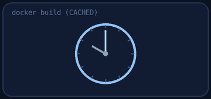
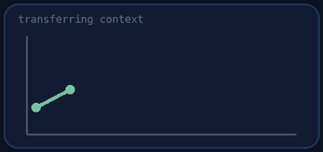
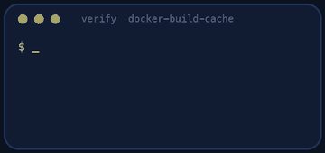
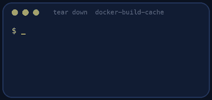

<p align="center"></p>

| | |
|-|-|
| **Time** | 90-105 min |
| **Cost** | free on your own machine |
| **You need** | Docker with BuildKit (any current Docker), git, curl, Python 3 and a terminal (on Windows use WSL) |

## How this lab works

1. **Fork** this repository to your own GitHub account (button at the top right).
2. Clone **your fork** in your Ubuntu environment (WSL on Windows, your OrbStack machine on Mac).
3. Read the lab below (the same text is in [`LAB.md`](LAB.md)) and follow the mission.
4. Answer the questions in [`SUBMISSION.md`](SUBMISSION.md). Where a question asks for output, paste it in a code block. No screenshots needed.
5. Commit and push. Open the **Actions** tab of your fork (click *I understand my workflows, go ahead and enable them* the first time). The **Lab check** shows what is still missing.
6. When the check is green, **submit the URL of your fork** in the course platform.

> [!NOTE]
> The check only looks at your answers and any files the lab asks you to commit. Your instructor reads your work and may ask you to explain any line.

<p align="center"></p>

## 🎬 The situation

<p align="center"></p>

Pollie's CI builds its API image on every commit. It takes minutes, and it takes the same minutes whether you changed one comment or the whole application. Developers push less often because of it. Last week somebody suggested "just caching the layers in CI", and then nobody could explain why the cache they already have never helps.

The cause is almost always the same, and it is not in CI. It is in the order of the lines of the `Dockerfile` and in a missing `.dockerignore`. Docker's build cache is simple and strict, and once you know its single rule you can make a build that takes a second where it took a minute. You will measure first, then fix, then prove that the cache is **correct** (a changed dependency file must still rebuild the dependencies) and not merely fast.

> [!IMPORTANT]
> **Your mission**
> - Measure `Dockerfile.slow` with `./measure.sh`: cold build, unchanged rebuild, one changed line of Python, changed requirements
> - Understand the cache rule and spot the instruction that breaks it
> - Write `Dockerfile.fast` and `.dockerignore`
> - Prove the speed-up and the correctness with `./verify.sh`
> - Tear down and prove it

**Time:** 90-105 min | **Cost:** free | **You need:** Docker with BuildKit and the `buildx` plugin (Docker Desktop has both; on Linux install `docker-buildx`), git, curl, Python 3 and a terminal. On Windows use WSL.

<p align="center"></p>

## Part 0 - Set the scene

Fork this repository, clone your fork and run `./setup.sh`. It clones Pollie and creates `data/sample.bin`, 40 MB of random bytes that stand for everything a real repository carries and an image never needs (build output, datasets, `node_modules`, a long git history). Read `Dockerfile.slow`: it is short.

<p align="center"></p>

## Part 1 - Measure

<p align="center"></p>

```bash
./measure.sh Dockerfile.slow
```

It builds four times and prints the time, the number of cached steps and the size of the build context: (1) cold, (2) nothing changed, (3) after appending a comment to one Python file, (4) after appending a comment to `requirements.txt`. Write the four lines down.

Look at line 3. You changed one comment, and the dependencies were installed again. Look at the context column: Docker uploaded the folder to the build daemon before running anything, including your 40 MB file.

> [!NOTE]
> **Predict** Docker caches a layer when the instruction and everything it depends on are unchanged. For `COPY . /app` "everything it depends on" is the content of every file in the context. What does that mean for the `RUN pip install` that comes after it? Write the rule down in one sentence (question 2).

<p align="center"></p>

## Part 2 - The rules

1. **A layer is reused if its instruction and its inputs are identical to a previous build.** The first layer that is not reused invalidates **every layer after it**.
2. So order the Dockerfile from **least often changed** to **most often changed**: the operating system packages, then the dependency list, then the dependencies themselves, and the application code **last**.
3. `COPY` takes the content of the files as input. Copy only what the next `RUN` needs: `requirements.txt` before `pip install`, the code after.
4. The **build context** is everything you send to the builder. `.dockerignore` removes files from it, which makes every build faster and keeps secrets out of images.
5. `apt-get update` in its own `RUN` is cached forever; a later `install` then uses a stale package index. Always `update && install` in the same `RUN`, and delete the lists in that same `RUN` so they do not stay in the layer.
6. BuildKit's `RUN --mount=type=cache,target=/root/.cache/pip` keeps pip's download cache **outside the image** between builds on the same machine, so a changed requirements file does not re-download everything.

<p align="center"></p>

## Part 3 - Write it

Fill in `Dockerfile.fast` and `.dockerignore` (the comments list the requirements). Then:

```bash
./measure.sh Dockerfile.fast
```

Compare with Part 1. Line 3 must be about a second. Line 4 (changed requirements) is **allowed** to be slower: the dependency layer *must* be rebuilt when the dependency list changes. A cache that does not notice that is a bug, not a feature.

> [!NOTE]
> **Think** The pip cache mount helps on your laptop because the cache lives on your laptop. On a CI runner that starts clean for every job, there is no previous build. What could you use instead? (Look up `--cache-from`, `--cache-to` and the `type=gha` or `type=registry` cache back ends.)

<p align="center"></p>

## Part 4 - Prove it

<p align="center"></p>

```bash
./verify.sh
```

It reads your Dockerfile, builds it cold, unchanged, after a source change and after a requirements change, and checks which steps were cached each time, the size of the context, and that the image still runs your application. It takes 3 to 5 minutes. Fix what is red and run it again until it ends with **ALL CHECKS PASSED**.

> [!TIP]
> **Stuck?** The pip layer is rebuilt after a code change: you copied the whole folder before installing. The context is still big: `.dockerignore` must contain `data` and `.git`. `import pollie` fails in the image: after your `COPY pollie/pollie ./pollie` the package must sit at `/app/pollie`. `the buildx component is missing`: install it (Linux).

<p align="center"></p>

## Level up (optional)

- Add `--cache-to type=registry` / `--cache-from` and measure a build on a machine with an empty local cache.
- Turn `Dockerfile.fast` into a multi-stage build and compare the sizes. Where does `libpq` belong?
- Run `docker buildx build --progress=plain` and read the time of each step. Which step is now the slowest, and is it worth optimising?
- Set `BUILDKIT_PROGRESS=plain` in a CI log and look at what "CACHED" means in the output.

<!-- teardown:start (generated by labs.py, do not edit) -->
## Tear down (mandatory)

<p align="center"></p>

Resources left behind cost money, keep doors open and pollute the next lab. Removing what you created is part of the job, so it is part of the submission: **you must prove it is gone**.

Do this **last**, after you have pasted your `verify` output into `SUBMISSION.md` (once you tear down, the lab can no longer be verified).

1. Run `./teardown.sh`. It removes the lab images, the build cache of the lab, the cloned Pollie source and the 40 MB junk file.

Then run the proof:

```bash
./verify-teardown.sh
```

It prints a list of checks and must end with **TEARDOWN VERIFIED**. If it reports leftovers, remove them and run it again. Paste the full output in your submission.
<!-- teardown:end -->

<!-- submission:start (generated by labs.py, do not edit) -->
## 📬 Submission

Answer the questions in `SUBMISSION.md` in **your fork** (paste output in code blocks where asked), push, then submit the **URL of your fork**.

**Files to commit**

- `Dockerfile.fast`: the fast build
- `.dockerignore`

**Questions to answer**

1. Paste the output of `./measure.sh` for the slow Dockerfile (cold build, then a one-line source change). Which step took the time on the second build, and why did Docker not reuse it?
2. Explain the cache rule in your own words: when does Docker reuse a layer and when does it throw away that layer and every layer after it? Which instruction in `Dockerfile.slow` broke the chain?
3. Paste the line `transferring context` for the slow and for the fast build. What is the build context, why does a large one slow every build, and what does `.dockerignore` change?
4. Paste `./measure.sh` for your Dockerfile. How much faster is the rebuild after a source change? And after a change to `requirements.txt`? Why is the second one allowed to be slow?
5. What does `RUN --mount=type=cache,target=/root/.cache/pip` do that `pip install --no-cache-dir` does not? When does the cache mount NOT help (hint: CI runners that start empty), and what could you use there?
6. Why must `apt-get update` and `apt-get install` be in the same `RUN`? Show the failure you get otherwise a few weeks later.
7. Paste the output of `./verify.sh`. It must end with **ALL CHECKS PASSED**.
8. **Tear down.** Paste the output of `./verify-teardown.sh`. It must end with **TEARDOWN VERIFIED**.
<!-- submission:end -->
